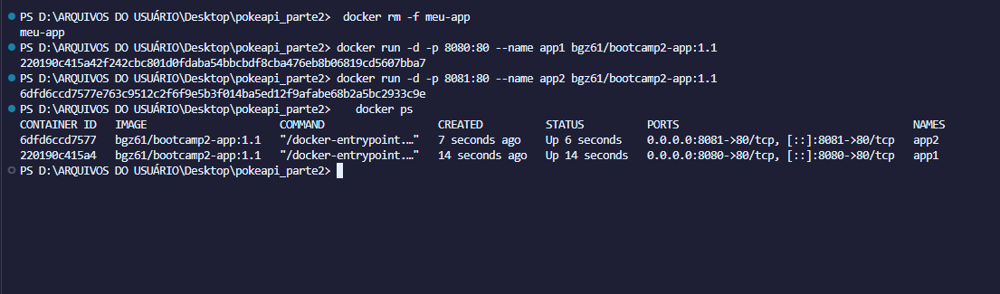

# PokeBusca

## Autor

**Nome completo:** Gabriel Borges de Souza Santiago — **RA:** 22607168

## Descrição

O PokeBusca é uma Pokédex online que permite pesquisar um Pokémon pelo nome ou número. A aplicação consulta a PokéAPI e apresenta imagem, número, tipos, altura, peso e habilidade principal.

Na **Etapa 02**, a aplicação ganhou **persistência de dados**: o usuário pode favoritar Pokémon, e os favoritos ficam salvos em um banco de dados PostgreSQL (Supabase). Além disso, a aplicação foi **conteinerizada com Docker** (Nginx) e publicada no Docker Hub.

## Links

- **Repositório (GitHub):** https://github.com/gabrielborgess-eng/bootcamp2-pokedex
- **Aplicação no ar (GitHub Pages):** https://gabrielborgess-eng.github.io/bootcamp2-pokedex/
- **Imagem no Docker Hub:** https://hub.docker.com/r/bgz61/bootcamp2-app

## Como executar com Docker

Com o Docker instalado, basta uma linha:

```bash
docker run -d -p 8080:80 bgz61/bootcamp2-app:1.1
```

Depois acesse **http://localhost:8080**.

Para parar e remover o container: `docker rm -f <id-ou-nome>`.

## Persistência de dados

- **Banco escolhido:** Supabase (PostgreSQL), plano gratuito, região South America (São Paulo).
- **Acesso:** o frontend conversa com a API REST do Supabase (`/rest/v1/favoritos`) usando `fetch`, com a chave pública (publishable/anon). Não há servidor próprio.
- **O que é salvo:** os Pokémon favoritados pelo usuário.
- **Operações:** criar (botão **Favoritar**), listar (seção **Meus favoritos**, carregada ao abrir a página) e excluir (botão ✕ em cada item).

### Estrutura da tabela `favoritos`

| Coluna | Tipo | Descrição |
|---|---|---|
| `id` | bigint (identity, PK) | identificador do registro |
| `criado_em` | timestamptz (default `now()`) | data e hora em que foi favoritado |
| `nome_item` | text (not null) | nome do Pokémon |
| `dados_extra` | jsonb | `{ id, imagem, tipos }` do Pokémon |

### Limitação conhecida

O RLS (Row Level Security) está ativado, mas com **políticas abertas para o papel `anon`** (select, insert e delete), como permitido nesta etapa. Isso significa que qualquer visitante pode ler, criar e excluir favoritos, e que todos veem a mesma lista (não há login por usuário). A chave usada no código é a **publishable/anon**, feita para o frontend; a chave secret/service_role **não** é utilizada. Em um produto real seriam necessárias autenticação e políticas por usuário.

## Funcionalidades

- Busca de Pokémon por nome ou número (PokéAPI);
- Exibição da imagem oficial, nome, número, tipos, altura, peso e habilidade;
- Favoritar um Pokémon e salvá-lo no banco de dados;
- Lista "Meus favoritos" carregada ao abrir a página, com botão para ver e para excluir cada item;
- Mensagens de carregamento e de erro;
- Layout responsivo.

## Evidências das sidequests

### SQ1 · `.dockerignore`

O arquivo `.dockerignore` exclui `.git`, `.gitignore`, `.vscode`, `README.md`, `Dockerfile`, `.dockerignore`, `*.png` e `*.jpg`.

Isso deixa a imagem menor e o build mais rápido porque o Docker envia ao motor, antes de construir, todo o **contexto de build** (a pasta do projeto). Sem o `.dockerignore`, itens como a pasta `.git` (com todo o histórico), prints e rascunhos seriam enviados e poderiam acabar dentro da imagem. Com ele, só o necessário entra: o contexto é menor, a transferência é mais rápida, o cache de camadas é invalidado com menos frequência e a imagem final não carrega arquivos inúteis ou sensíveis.

- Contexto de build **antes** do `.dockerignore`: 21.62 kB
- Contexto de build **depois** do `.dockerignore`: **5.08** kB

Redução de cerca de 76% no contexto enviado ao Docker (21.62 kB → 5.08 kB). O log do build também mostra o próprio `.dockerignore` sendo lido: `load .dockerignore → transferring context: 112B`.

### SQ2 · Versionamento de imagem

Tags publicadas no Docker Hub:

- `1.0`: primeira versão funcional (busca + favoritos);
- `1.1`: após melhoria (rodapé atualizado);
- `latest`: aponta para a versão mais recente.

```bash
docker tag bootcamp2-app bgz61/bootcamp2-app:1.1
docker tag bootcamp2-app bgz61/bootcamp2-app:latest
docker push bgz61/bootcamp2-app:1.1
docker push bgz61/bootcamp2-app:latest
```

Evidência: aba **Tags** do repositório https://hub.docker.com/r/bgz61/bootcamp2-app/tags

### SQ3 · Descrição no Docker Hub

O overview do repositório descreve a aplicação, traz o comando `docker run` pronto para copiar e o link do repositório no GitHub: https://hub.docker.com/r/bgz61/bootcamp2-app

### SQ4 · Orquestração

Duas instâncias da mesma imagem rodando ao mesmo tempo, nas portas 8080 e 8081:

```bash
docker run -d -p 8080:80 --name app1 bgz61/bootcamp2-app:1.1
docker run -d -p 8081:80 --name app2 bgz61/bootcamp2-app:1.1
docker ps
```

Print do `docker ps`: 

**E se eu tivesse 100 containers, como gerenciaria?** Subir e acompanhar 100 containers com `docker run` manual é inviável: seria preciso distribuí-los entre várias máquinas, reiniciar os que caem, atualizar versões sem tirar o serviço do ar e balancear o tráfego. É para isso que existe o **Kubernetes**, um orquestrador de containers. Seus conceitos centrais são: o **cluster**, o conjunto de máquinas (nós) gerenciadas em conjunto, com um plano de controle que decide onde cada carga roda; o **pod**, a menor unidade de execução, que encapsula um ou mais containers que compartilham rede e armazenamento; e a **réplica**, cada cópia idêntica de um pod. Declarando, por exemplo, "quero 100 réplicas desta imagem", o Kubernetes distribui os pods pelos nós, recria automaticamente os que falham, permite escalar para mais ou menos réplicas e faz atualizações graduais (rolling update). O que fiz aqui com duas portas manualmente é, em miniatura, o que o Kubernetes automatiza em larga escala.

## Estrutura do projeto

```text
bootcamp2-pokedex/
├── index.html      # estrutura da página
├── style.css       # estilos e responsividade
├── script.js       # busca na API, favoritos (Supabase) e interação
├── Dockerfile      # imagem Nginx servindo a aplicação
├── .dockerignore   # arquivos fora do contexto de build
├── docker-ps.png   # evidência da SQ4
└── README.md       # documentação do projeto
```

## Créditos

Os dados dos Pokémon são fornecidos gratuitamente pela [PokéAPI](https://pokeapi.co/). Este projeto não possui vínculo oficial com a The Pokémon Company ou a Nintendo.