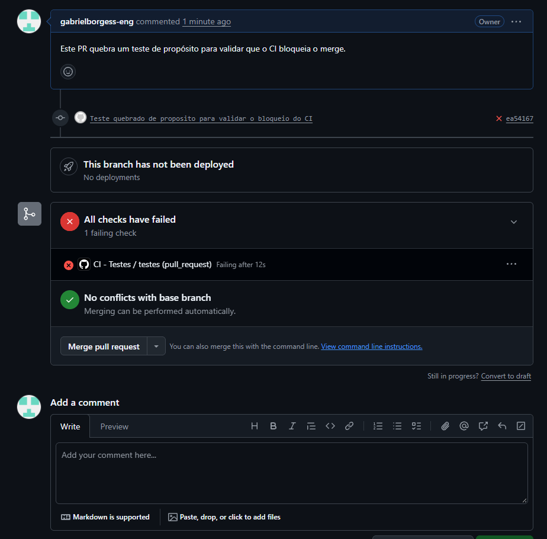
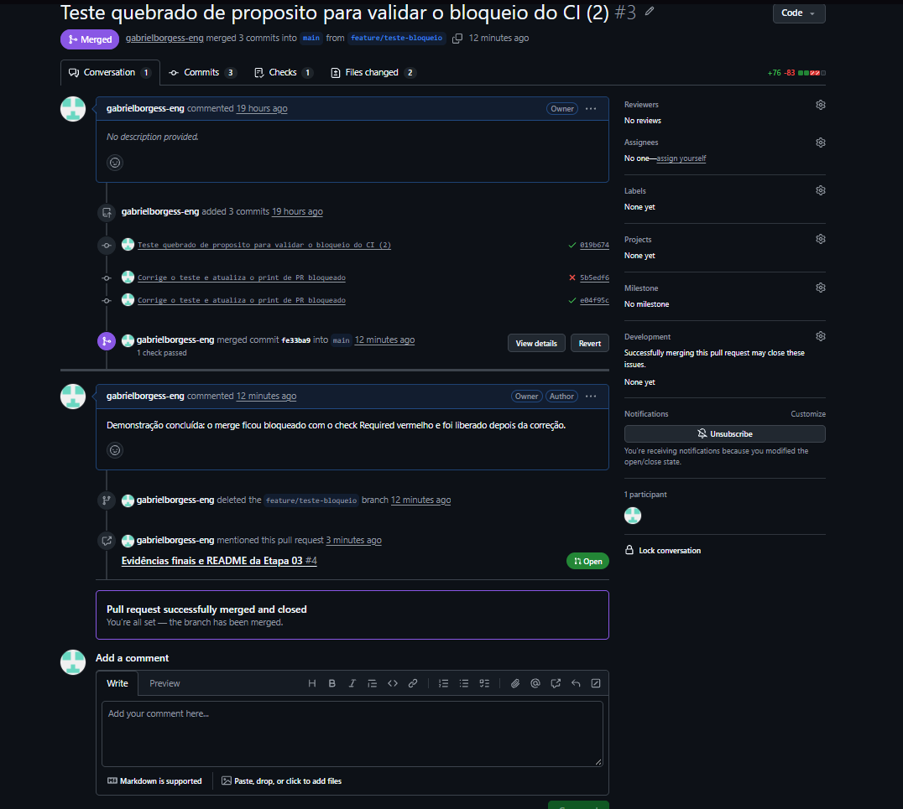

# PokeBusca — Projeto Final (Etapa 03)

Pokédex online com favoritos salvos em banco de dados, testes automatizados, integração contínua (GitHub Actions) e imagem Docker publicada.

> **Trabalho individual.** O professor autorizou a realização desta etapa sozinho; por isso o grupo tem um único integrante e a proteção da `main` não exige aprovação de revisor (o GitHub não permite aprovar o próprio PR). Todo código entra por Pull Request, com o check de testes obrigatório.

## 1. Integrantes

| Nome | Matrícula (RA) | Usuário GitHub | Funcionalidades sob responsabilidade | Principal PR |
|---|---|---|---|---|
| Gabriel Borges de Souza Santiago | 22607168 | [gabrielborgess-eng](https://github.com/gabrielborgess-eng) | Frontend, integração com a PokéAPI, persistência (Supabase), testes automatizados, CI (GitHub Actions) e Docker/Docker Hub | [PR #1: testes e CI](https://github.com/gabrielborgess-eng/bootcamp2-pokedex/pull/1) |

## 2. Aplicação

O PokeBusca busca um Pokémon pelo nome ou número e mostra imagem, número, tipos, altura, peso e habilidade principal. O usuário pode **favoritar** Pokémon; os favoritos ficam salvos em um banco de dados e são listados ao abrir a página, com opção de excluir.

- **API externa consumida:** [PokéAPI](https://pokeapi.co/docs/v2) — `GET https://pokeapi.co/api/v2/pokemon/{nome-ou-numero}` (sem autenticação).
- **Banco de dados:** Supabase (PostgreSQL), acessado direto do frontend pela API REST (`/rest/v1/favoritos`) com `fetch`, usando a chave pública (publishable/anon).
- **Interface:** HTML, CSS e JavaScript puro.

### Tabela `favoritos`

| Coluna | Tipo | Descrição |
|---|---|---|
| `id` | bigint (identity, PK) | identificador |
| `criado_em` | timestamptz (default `now()`) | data e hora do favorito |
| `nome_item` | text (not null) | nome do Pokémon |
| `dados_extra` | jsonb | `{ id, imagem, tipos }` |

**Limitação conhecida:** o RLS está ativado com políticas abertas para `anon` (select, insert e delete). Qualquer visitante vê e altera a mesma lista, pois não há login por usuário. A chave secret/service_role não é usada.

## 3. Links

- **Repositório:** https://github.com/gabrielborgess-eng/bootcamp2-pokedex
- **Aplicação (GitHub Pages):** https://gabrielborgess-eng.github.io/bootcamp2-pokedex/
- **Docker Hub:** https://hub.docker.com/r/bgz61/bootcamp2-app

## 4. Como executar

### Via Docker (recomendado)

```bash
docker run -d -p 8080:80 bgz61/bootcamp2-app:2.0
```

Depois abra **http://localhost:8080**. A aplicação não precisa de variáveis de ambiente: a URL e a chave pública do Supabase já estão no código. Para parar: `docker rm -f <id-ou-nome>`.

### Localmente (sem Docker)

```bash
git clone https://github.com/gabrielborgess-eng/bootcamp2-pokedex.git
cd bootcamp2-pokedex
python -m http.server 8000
```

Acesse http://localhost:8000 (ou use a extensão Live Server do VS Code). É preciso internet para acessar a PokéAPI e o Supabase.

## 5. Como rodar os testes

Requer Node.js 20 ou superior.

```bash
npm install
npm test
```

São **10 testes** (Jest) em `utils.test.js`, cobrindo as funções puras de `utils.js`: validação da busca, normalização do termo, formatação de nome, número, altura e peso, e checagem de favorito.

## 6. Integração contínua e proteção da `main`

- **Workflow:** `.github/workflows/ci.yml` ("CI - Testes") roda `npm install` e `npm test` a cada Pull Request e a cada push na `main`.
- **Proteção da `main` (ruleset):**
  - exige Pull Request antes do merge (ninguém commita direto na `main`);
  - exige que o check **`testes`** passe antes do merge;
  - aprovações exigidas: 0, por ser um trabalho individual (autorizado pelo professor).
- **Branches** seguem o padrão `feature/<descricao>`.

## 7. Evidências

### PR bloqueado pelo CI

Abri um PR de propósito com um teste quebrado ([PR #3](https://github.com/gabrielborgess-eng/bootcamp2-pokedex/pull/3)). O check **CI - Testes** ficou vermelho, marcado como **Required**, e o GitHub bloqueou o merge (botão desabilitado). Depois da correção, o check passou e o merge foi liberado.

Observação: no PR #2 (a primeira tentativa) o ruleset da `main` ainda não estava ativo, por isso o merge não ficou bloqueado. Corrigi a configuração (ruleset `proteger-main`, com Pull Request e o check `testes` obrigatórios) e repeti o teste no PR #3.





### Conflito de merge

Nos PRs desta etapa **não houve conflito de merge**, pois só uma pessoa alterou o código. O único conflito de histórico ocorreu na Etapa 02, quando o repositório local e o do GitHub tinham históricos diferentes (arquivos enviados pelo site); foi resolvido com `git pull --allow-unrelated-histories -X ours`, mantendo a versão local do código.

### Pull Requests

| PR | Descrição | Resultado |
|---|---|---|
| [#1](https://github.com/gabrielborgess-eng/bootcamp2-pokedex/pull/1) | Adiciona testes automatizados e CI com GitHub Actions | check verde, mesclado |
| [#2](https://github.com/gabrielborgess-eng/bootcamp2-pokedex/pull/2) | Primeira tentativa de teste quebrado (proteção ainda não ativa) | check vermelho, mas o merge não foi bloqueado; mesclado após a correção |
| [#3](https://github.com/gabrielborgess-eng/bootcamp2-pokedex/pull/3) | README final e teste quebrado de propósito para validar o bloqueio do CI | check vermelho (merge bloqueado) e depois verde, mesclado |

## 8. Estrutura do projeto

```text
bootcamp2-pokedex/
├── .github/workflows/ci.yml   # workflow de testes (GitHub Actions)
├── index.html                 # estrutura da página
├── style.css                  # estilos
├── utils.js                   # funções puras (testadas)
├── utils.test.js              # testes Jest
├── script.js                  # busca na API, favoritos (Supabase) e interface
├── package.json               # scripts e dependências de teste
├── Dockerfile                 # imagem Nginx
├── .dockerignore              # arquivos fora do contexto de build
└── README.md
```

## Créditos

Dados fornecidos pela [PokéAPI](https://pokeapi.co/). Projeto sem vínculo oficial com The Pokémon Company ou a Nintendo.